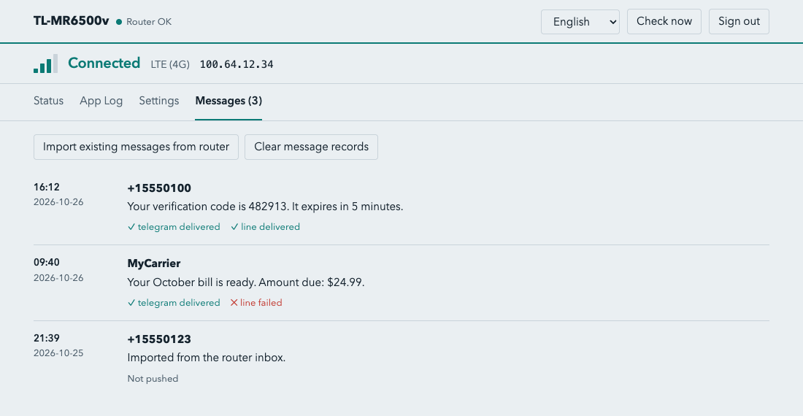
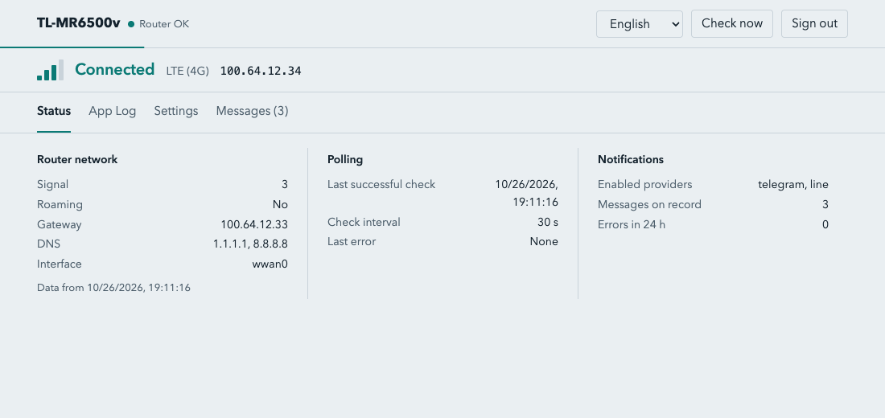

<p align="center"></p>

# TL-MR6500v

[](https://github.com/jcluox/tl-mr6500v/actions/workflows/ci.yml)
[](LICENSE)

Get an instant alert for every new SMS that arrives on a TP-Link TL-MR6500v home SIM router. You can turn on several providers at once (Telegram and LINE for now), and each one gets the full text of the message.

<picture>
  <source media="(prefers-color-scheme: dark)" srcset="assets/screenshot-messages-dark.png">
  
</picture>

> **Unofficial project.** It is not made, endorsed or supported by TP-Link. The router protocol was worked out by reading the router's own web interface, using the author's device. Use it at your own risk; it comes with no warranty (see [LICENSE](LICENSE)).

## Compatibility

Tested on one TL-MR6500v. Other models and firmware versions may behave differently. If you try it on another one, please open an issue and tell us what happened.

## How it works

1. The app logs in to the router's web interface with the password in `.env`.
2. Every `POLL_INTERVAL_SECONDS` seconds it checks the inbox, then logs out. (The router allows only one logged-in user at a time.)
3. When a new message arrives, it is sent to all enabled providers at once. If one provider fails, the others still get the message.
4. Events (start-up, new messages and their delivery results, checks skipped because someone is logged in) are written to `logs/app.log`. Errors, such as push failures, also go to `logs/error.log`. The same log is also saved in SQLite so you can read it in the Dashboard.
5. Messages that were already handled are remembered in `data/seen.json`, so nothing is pushed twice after a restart. **On the first start the app only records the existing messages. It does not push old ones.**
6. Pushed messages (and messages imported on the first start), with each provider's delivery result, are saved in `data/app.db` and shown in the Dashboard.

> If you are logged in to the router in a browser, the app notices this and skips that check by default, so it does not log you out. Messages that arrive in the meantime are pushed on a later check. You can change this in the Dashboard settings to force the login (which logs the other person out).

## Dashboard

After starting, open `http://localhost:6500` (Docker) or `http://localhost:8000` (without Docker). Sign in with `ADMIN_USERNAME` and `ADMIN_PASSWORD`. A login stays valid for `SESSION_DAYS` (30) days, and each use renews it. After 5 failed sign-ins in a row, that source is locked out for 5 minutes.

The Dashboard has four tabs, and its language can be changed (Traditional Chinese, Simplified Chinese, English, Japanese):

- **Status**: the LTE connection (state, network type, signal, IP, gateway, DNS), polling details, and push details. The network details are read during each poll, so the app does not log in to the router an extra time.
- **App Log**: filter by level (all / warnings and above / errors only). When there were errors in the last 24 hours, a warning bar appears at the top.
- **Settings**: saved in SQLite and applied right away, with no restart:
  - Check interval (5-3600 seconds)
  - Whether to force the login and log out a user who is already logged in to the router (off by default)
  - Whether other devices on the local network may open the Dashboard (off by default, so only this machine can)
  - Whether to also push error messages to the providers (off by default; the same error is pushed at most once every 30 minutes)
- **Messages**: the full text of each pushed message and each provider's delivery result. The tab shows how many records there are.
  - "Import existing messages from router" adds the latest `IMPORT_LIMIT` old messages from the router inbox to the records. They are only saved, not pushed, and are marked "Not pushed". The same import runs once on the first start.
  - "Clear message records" deletes only the records in the database. It never deletes messages on the router, and nothing is pushed again.

<picture>
  <source media="(prefers-color-scheme: dark)" srcset="assets/screenshot-status-dark.png">
  
</picture>

The thin line under the top bar counts down to the next check and starts over on every check.

### Local network access

The "Allow other devices on the local network" setting is decided by the source IP:

- Sources in `LOCAL_CLIENT_CIDRS` (loopback by default) count as this machine and are always allowed.
- When the setting is on, other private networks (10/8, 172.16/12, 192.168/16 and so on) are allowed too.
- Public sources are always rejected.

Notes for Docker:

1. `docker-compose.yaml` publishes the port on `127.0.0.1:6500` only. To open it to the local network, change it to `"6500:8000"`.
2. Docker Desktop (macOS and Windows) makes every connection come from the bridge gateway's IP, so the app cannot tell this machine from the local network. If you see a 403, either turn on the local network setting or add the gateway address to `LOCAL_CLIENT_CIDRS`, and use the port binding in step 1 to control who can connect. Docker on Linux keeps the real source IP, so the setting works as expected there.

A rejected source is logged once as a warning in the App Log, so you can see which address to add to `LOCAL_CLIENT_CIDRS`.

## Security and privacy

This app handles your router password and your SMS, so please read this before you run it.

- **Keep it on a trusted network.** The Dashboard uses plain HTTP. Do not expose its port to the internet. For remote access, use a VPN or an HTTPS reverse proxy (the login cookie does not have the `Secure` flag, so HTTPS is needed in front).
- **Use a strong `ADMIN_PASSWORD`.** The app will not start if it is empty or still the example value.
- **Your data is stored in plain text.** `.env` holds the router password and provider tokens. `data/app.db` holds the full text of your messages, which can include one-time login codes. Protect these files.
- **Providers see your messages.** Telegram and LINE receive the full text of every message you push to them.
- **Never share real logs, screenshots or tokens in public issues.** Remove phone numbers and message text first.

To report a vulnerability, see [SECURITY.md](SECURITY.md).

## Settings

Copy the example file and fill it in:

```bash
cp .env.example .env
```

| Variable | Description | Default |
| --- | --- | --- |
| `TPLINK_PASSWORD` | Router login password (required) | |
| `ADMIN_PASSWORD` | Dashboard login password (required; use a different one from the router's) | |
| `ADMIN_USERNAME` | Dashboard username | `admin` |
| `SESSION_DAYS` | Days a Dashboard login stays valid (each use renews it) | `30` |
| `LOCAL_CLIENT_CIDRS` | Source networks treated as this machine, comma-separated | `127.0.0.0/8,::1/128` |
| `IMPORT_LIMIT` | Most recent messages to import; `0` = all | `20` |
| `ROUTER_HOST` | Router address | `http://192.168.1.1` |
| `POLL_INTERVAL_SECONDS` | The **initial** seconds between checks. After that, the Dashboard setting is used | `30` |
| `ENABLED_PROVIDERS` | Enabled providers, comma-separated, for example `telegram,line` | empty (nothing is pushed) |
| `TELEGRAM_BOT_TOKEN` / `TELEGRAM_CHAT_IDS` | Telegram bot token and the chat ids that receive messages (comma-separated) | |
| `LINE_CHANNEL_ACCESS_TOKEN` / `LINE_USER_IDS` | LINE Messaging API channel token and the user ids that receive messages (comma-separated) | |
| `DATA_DIR` / `LOG_DIR` | Folders for state and logs | `./data` / `./logs` |

> LINE Notify has been shut down, so the LINE provider uses the LINE Messaging API. You need to create a Messaging API channel.

## Start

### Docker (recommended)

```bash
docker compose up -d --build
docker compose logs -f
```

`./data` and `./logs` are mounted into the container, so state and error logs are kept when you rebuild it. The container must be able to reach the router's local IP address.

### Without Docker

You need [uv](https://docs.astral.sh/uv/):

```bash
uv sync
uv run uvicorn tl_mr6500v.main:app --host 0.0.0.0 --port 8000
```

## API

Except for `/health` and sign-in, every `/api/*` endpoint needs a login (cookie session).

| Endpoint | Description |
| --- | --- |
| `GET /health` | No login needed. `ok` (false if the last check failed) and the time of the last check. Used by the Docker healthcheck |
| `POST /api/auth/login` | `{"username", "password"}`. On success it sets an httpOnly cookie |
| `POST /api/auth/logout` / `GET /api/auth/me` | Sign out / the current user (the only role for now is `admin`) |
| `GET /api/status` | Polling state, enabled providers, errors in the last 24 hours |
| `GET /api/router` | Router state (`ok` / `busy` / `error`) and LTE connection details |
| `GET /api/messages?limit&offset` | Message history (newest first) with each provider's delivery result |
| `DELETE /api/messages` | Delete the message records in the database (router messages are not touched) |
| `POST /api/messages/import` | Import the latest messages from the router inbox into the history (nothing is pushed) |
| `GET /api/logs?level&limit&before_id` | App log; `level` is `INFO`, `WARNING` or `ERROR` |
| `GET /api/settings` / `PUT /api/settings` | Read / change the settings |
| `POST /api/poll` | Check now and return the new messages |

## Add a provider

1. Add a class in `src/tl_mr6500v/providers/` that extends `Provider` and implements `async send_text(text)`. Raise an exception on failure; the error is logged for you.
2. Register its name in `factories` in `providers/__init__.py`, and add the settings it needs to `config.py`.
3. Add the name to `ENABLED_PROVIDERS`.

## Development

While changing the code, use `docker compose watch` instead of `up -d`. A change in `src/` is synced into the container and restarts it, and a change in `pyproject.toml` rebuilds the image. For long-running use, use `docker compose up -d --build`.

```bash
docker compose watch
```

Run the tests:

```bash
uv run pytest
```

To add a Dashboard language, add it to `LANGUAGES` and `STRINGS` in `src/tl_mr6500v/static/i18n.js`. A test checks that every language has the same keys as English.

## Troubleshooting

- **Login failed (code=71233)**: wrong router password. After 5 wrong tries in a row, the router locks for about 10 minutes.
- **Skipping this check (someone is logged in to the router)**: before logging in, the app checks the router. If someone is using the web interface, it does not log in and tries again on the next round, so it never logs that person out.
- **The Dashboard shows 403 "Local access only"**: the source IP is not in the local networks. Check the warning in the App Log for the source IP (with Docker it is often `172.x` or `192.168.x`). Turn on the local network setting or add the address to `LOCAL_CLIENT_CIDRS`.
- **The app fails to start with a required `admin_password` field**: add `ADMIN_PASSWORD` to `.env`.
- **No notifications**: check `ENABLED_PROVIDERS` and the matching tokens. Push errors are in `logs/error.log`.
- **Missed old messages**: messages that arrive while the app is stopped are pushed after it restarts. Messages that existed before the first start (when `data/seen.json` did not exist yet) are not pushed.

## Contributing

Pull requests are welcome. See [CONTRIBUTING.md](CONTRIBUTING.md).

## License

[MIT](LICENSE)
